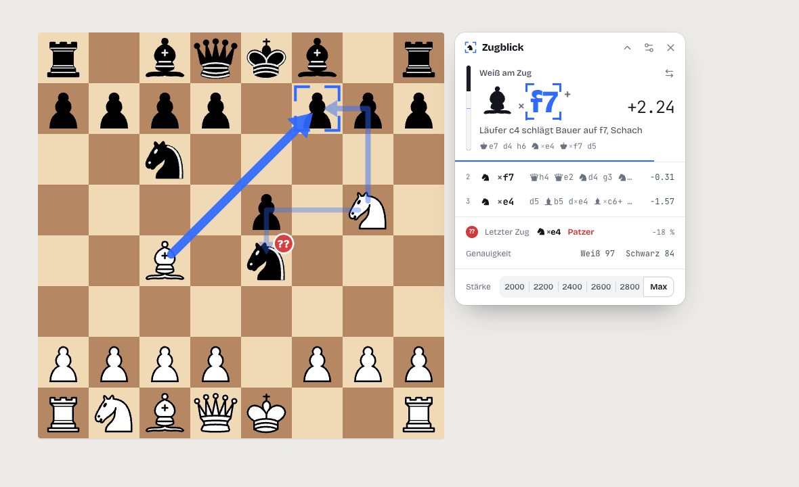

# Zugblick

**Stockfish in Echtzeit auf jeder Schachseite.** Zugblick ist eine Browser-Erweiterung für Chrome, Edge und Brave (Windows und macOS). Sie liest das Brett, das du gerade siehst, und zeigt dir sofort den besten nächsten Zug – als Pfeil direkt auf dem Brett und in einem kleinen, ruhigen Panel daneben.

<picture>
  <source media="(prefers-color-scheme: dark)" srcset="docs/zugblick-dunkel.png">
  
</picture>

## Was es kann

- **Bester Zug in Echtzeit** – Stockfish 19 rechnet bei jeder Stellungsänderung neu, Pfeil und Panel folgen sofort.
- **Mehrere Möglichkeiten** – bis zu fünf Varianten mit Bewertung und Fortsetzung, die Alternativen als dünnere Pfeile.
- **Figur anklicken** – zeigt den besten Zug genau dieser Figur und wie viel schwächer er als der beste Zug ist.
- **Stärke wählbar** – von 2000 Elo bis volle Stockfish-Stärke.
- **Züge bewerten** – Bester Zug, Gut, Ungenau, Fehler, Patzer direkt am Feld, dazu die Genauigkeit beider Seiten.
- **Drohung zeigen** – was der Gegner vorhat, wenn du nichts tust.
- **Jede Schachseite** – chess.com und lichess werden direkt gelesen, alles andere (Canvas-Bretter, Videos, Bilder) per Bilderkennung. Zugblick lernt die Figuren einer Seite, sobald einmal die Grundstellung zu sehen ist.
- **Hell und dunkel, Großansicht** für Beamer, Tastenkürzel **Alt+Shift+Z** zum Ein- und Ausblenden.
- **Läuft komplett lokal** – keine Konten, kein Server, keine Daten verlassen deinen Rechner.

## Installieren

Läuft in allen Chromium-Browsern: Chrome, Edge, Brave, Arc, Opera – auf Windows und macOS. Firefox und Safari werden noch nicht unterstützt.

### Am schnellsten: mit Claude

Gib deiner Claude-Instanz (Claude Code, Claude Desktop) einfach diesen Link und sag „Installier mir das“:

```
https://github.com/nikolajhellhoeflinger/zugblick
```

Claude liest die Anleitung in [`AGENTS.md`](AGENTS.md), lädt alles herunter und führt dich durch die zwei Klicks, die Chrome aus Sicherheitsgründen selbst von dir will.

### Mit einem Befehl

**macOS** (Terminal):

```bash
curl -fsSL https://raw.githubusercontent.com/nikolajhellhoeflinger/zugblick/main/scripts/install.sh | bash
```

**Windows** (PowerShell):

```powershell
irm https://raw.githubusercontent.com/nikolajhellhoeflinger/zugblick/main/scripts/install.ps1 | iex
```

Das Skript lädt die fertige Erweiterung nach `~/Zugblick` und öffnet die Erweiterungsseite deines Browsers. Danach:

1. Oben rechts **Entwicklermodus** einschalten.
2. **Entpackte Erweiterung laden** klicken und den Ordner `Zugblick` wählen.
3. Fertig. Öffne eine Schachseite – das Panel erscheint von selbst.

### Von Hand

1. Unter [Releases](https://github.com/nikolajhellhoeflinger/zugblick/releases/latest) die Datei `zugblick-chrome.zip` herunterladen und entpacken.
2. `chrome://extensions` öffnen (Edge: `edge://extensions`, Brave: `brave://extensions`).
3. **Entwicklermodus** einschalten, **Entpackte Erweiterung laden**, den entpackten Ordner wählen.

Tipp: Über das Puzzle-Symbol in der Browserleiste lässt sich Zugblick anheften.

## Bedienung

| | |
|---|---|
| Panel ein/aus | Klick auf das Zugblick-Symbol oder **Alt+Shift+Z** |
| Beste Möglichkeit einer Figur | die Figur auf dem Brett anklicken |
| Variante auf dem Brett zeigen | mit der Maus über die Zeile im Panel fahren |
| Wer ist am Zug? | wird erkannt; falls Zugblick raten muss, steht „geraten“ dabei – der Pfeil-Knopf daneben wechselt die Seite |
| Seite ohne erkanntes Brett | „Brett per Bild erkennen“ – Zugblick sucht das Brett selbst, sonst einen Rahmen darum ziehen |
| Panel verschieben | an der Kopfzeile ziehen; die Position wird je Seite gemerkt |

## Fair Play

Zugblick ist ein Analyse- und Lernwerkzeug. In Partien **gegen Menschen** verbieten chess.com, lichess und die meisten Schachseiten Engine-Hilfe, und Konten werden dafür gesperrt. Nutze Zugblick zum Analysieren, gegen Bots, für eigene Partien im Nachhinein und zum Lernen.

## Für Entwickler

```bash
pnpm install
pnpm dev        # Chrome mit Zugblick und Live-Neuladen
pnpm build      # → .output/chrome-mv3
pnpm zip        # → .output/zugblick-<version>-chrome.zip
pnpm bench      # Messbank der Bilderkennung (vorher: pnpm bench:collect lichess|chesscom)
```

Aufbau und Fallen stehen in [`AGENTS.md`](AGENTS.md).

## Danke

Zugblick baut auf freier Software auf:

- [Stockfish](https://stockfishchess.org) über [stockfish.js](https://github.com/nmrugg/stockfish.js) (GPL-3.0)
- [chess.js](https://github.com/jhlywa/chess.js) (BSD-2-Clause)
- [WXT](https://wxt.dev) (MIT), [React](https://react.dev) (MIT), [Tailwind CSS](https://tailwindcss.com) (MIT), [Radix UI](https://www.radix-ui.com) und [shadcn/ui](https://ui.shadcn.com) (MIT), [Lucide](https://lucide.dev) (ISC)
- Figuren „cburnett“ von Colin M. L. Burnett (GPLv2+), über [lichess](https://github.com/lichess-org/lila)
- Vorlagen der Bilderkennung aus den Figurensätzen cburnett, merida (GPLv2+), chessnut (Apache-2.0), fantasy, celtic (MIT) und mpchess (GPLv3+)
- Schriften [Bricolage Grotesque](https://github.com/ateliertriay/bricolage) und [JetBrains Mono](https://www.jetbrains.com/lp/mono/) (SIL OFL 1.1)

## Lizenz

[GPL-3.0-or-later](LICENSE) – weil Stockfish unter der GPL steht, gilt das auch für Zugblick.
